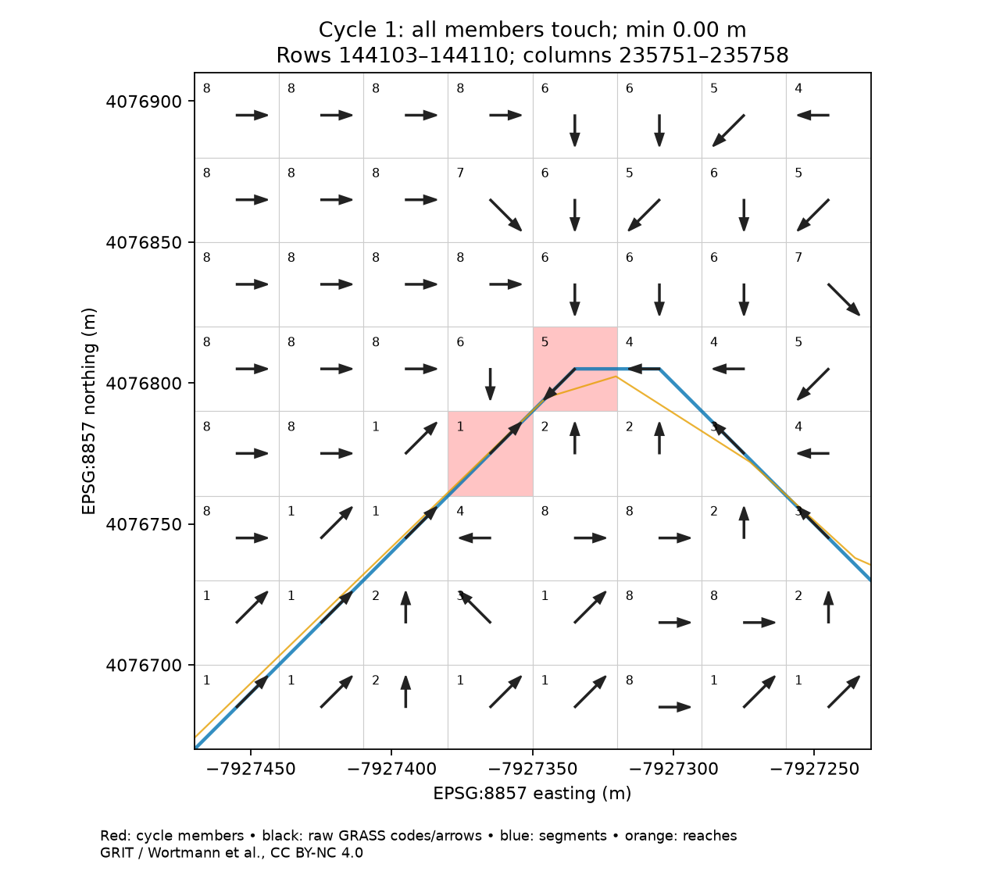
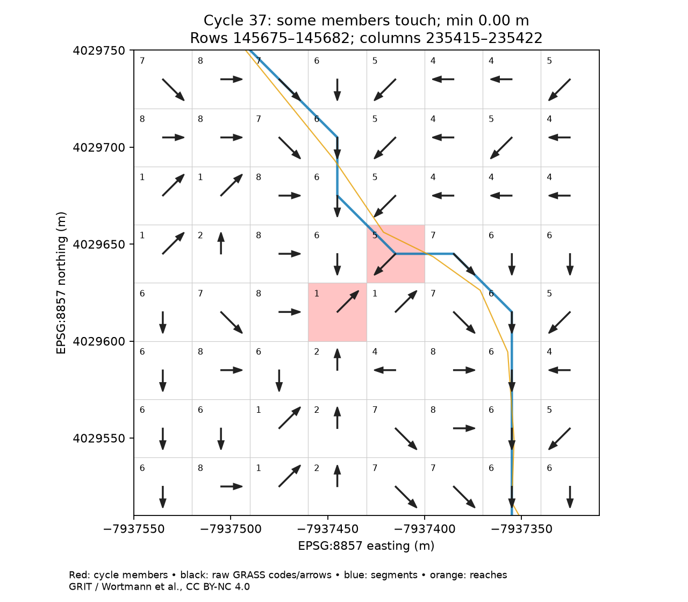
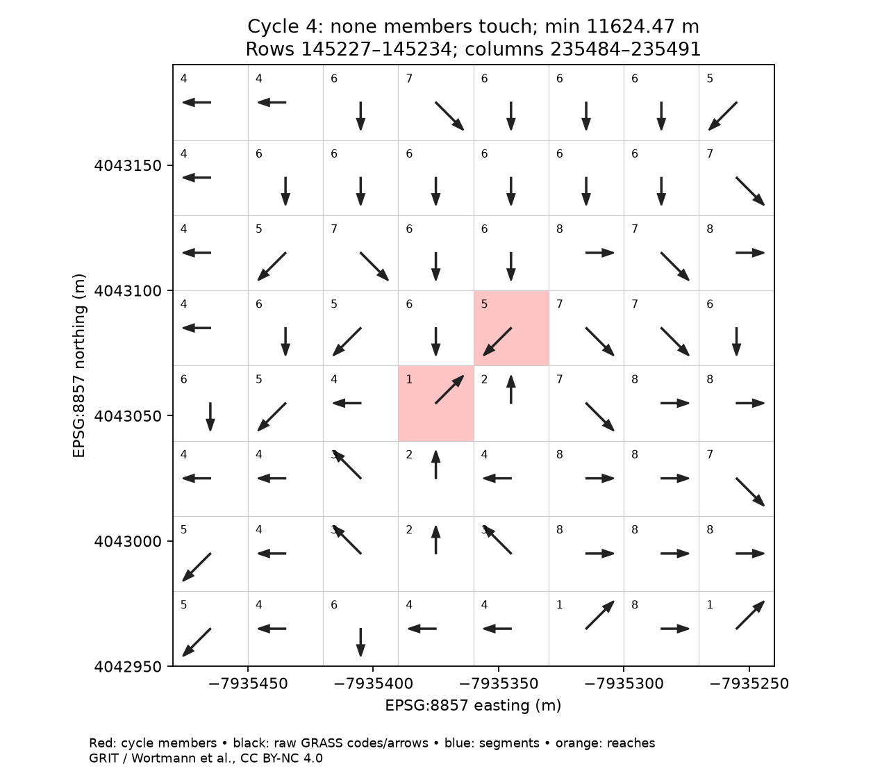
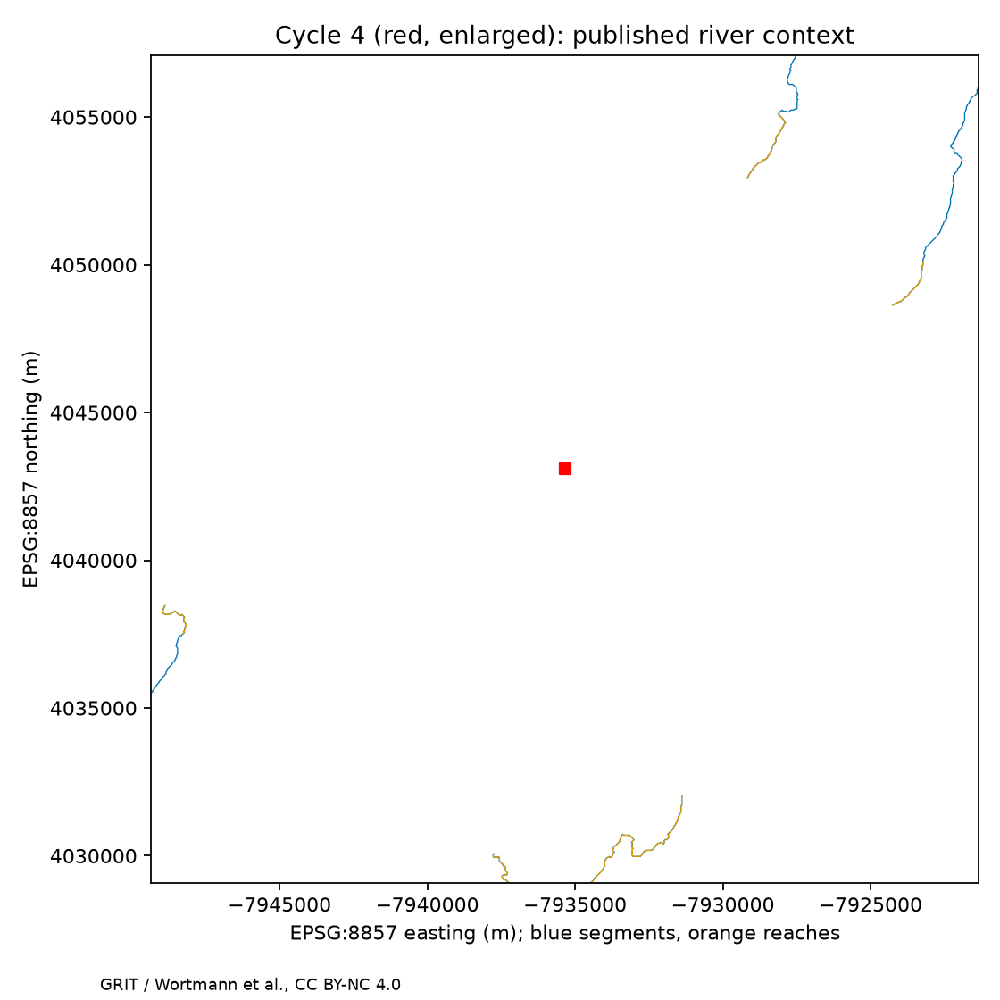

# GRIT cycle cells and published rivers

[Vision](../../planning/visions/2026-11-09-grit-cycle-stream-mapping-hypothesis.md) · [#277](https://github.com/pourpoint-tools/hfx/issues/277) · [originating discussion #269](https://github.com/pourpoint-tools/hfx/issues/269)

**28 of the 294 known directed cycles intersect published rivers exactly.** Eight have every member touching; 20 have only some members touching. The other 266 have no exact intersection. One of these misses by only 1.44×10⁻⁹ projected metres: with a **1 µm numerical sensitivity threshold**, 29 cycles touch and 265 do not. This is floating-point boundary sensitivity, not a meaningful hydrologic gap.

**Original stream-cell membership and cause remain unresolved.** These results challenge using the published lines as a complete proxy for the stream cells Michel modified. They neither disprove his workflow nor establish direction enforcement or imprecise mapping as the cause.

## Observations

| Unit / denominator | Result |
|---|---:|
| Distinct directed cycles | 294 |
| Cycle-member cells, not contributing cells | 666 |
| Members exactly touching any published river / 666 | 41 |
| Cycles with any member exactly touching / 294 | 28 |
| Cycles with every member exactly touching / 294 | 8 |
| Cycles with no exact touch / 294 | 266 |
| Members outside the historical vector mask / 666 | 104 |
| Cycles with at least one outside-mask member / 294 | 42 |
| Segment-level any / all member touch | 28 / 8 cycles |
| Reach-level any / all member touch | 25 / 8 cycles |

For the 266 exact non-overlaps, nearest **cell-footprint** distance has minimum 1.44×10⁻⁹ m, median **2,128.19 m**, and maximum **11,624.47 m**. These are Euclidean **EPSG:8857 grid-coordinate metres**, not geodesic ground distances. Equal Earth preserves area, not distance.

| Minimum cycle distance | Cycles |
|---|---:|
| Exactly zero | 28 |
| >0 to 1 µm | 1 |
| >1 µm to 30 m | 2 |
| >30 to 100 m | 10 |
| >100 to 1,000 m | 59 |
| >1,000 to 5,000 m | 150 |
| >5,000 m | 44 |

No distance threshold is treated as original stream-mask membership. No spatial grouping merges nearby loops: one cycle is one closed directed sequence. [Per-cycle inventory](results/inventory.json) retains native global zero-based row/column, raw GRASS code, mask-center membership, per-member distances for both river tiers, nearest river/source ID, and any/all/none classification. Nearest IDs can tie where levels share geometry.

## Recovery and identity

The historical `hfx269-coverage/exhaustive_summary.json` contains **292**, not 294, cycles. Its `edge_continuations.json` contains five paths ending in cycles, but only **two distinct additional cycles** after rotation-invariant deduplication. Together they give exactly **294 cycles and 666 members**; no mismatch or substituted global survey. Lengths: 242 two-cell, 39 three-cell, five four-cell, six five-cell, one six-cell and one nine-cell cycle.

The [compact recovered input](results/recovered-input.json) preserves all member sequences from these two files. [Inventory input hashes](results/inventory.json) identify the full local historical files, cache, original source tile and acquired rivers. Canonical IDs in this report sort cycles by minimum native cell and preserve directed order; they are not historical endpoint IDs. Every sequence is checked for unique members and complete directed closure. Every raw member value is reread from the original Zenodo v1.0 direction tile and agrees, including members outside the original cached window. Native grid alignment and EPSG:8857 are checked, without resampling.

The historical basin mask is the upstream segment-catchment union ending at source segment **190026628**. Its selected terminal-channel diagnostic is global `(148032,235090)`, `(-89.32299563991558,31.639357487809487)`, not the CAMELS gauge or declared vector outlet. Mask membership uses the saved cell-center mask, not intersection area. Outside the cached mask extent is outside this basin mask; cycles are not clipped there.

Earlier exhaustive tracing assigned **1,625,331 / 1,625,680 omitted mask centers** to these 294 cycles. Those contributing centers are **not** cycle members. The earlier 282 centers unresolved beyond source tile row 150000 remain unresolved; this experiment does not reclassify them or claim all possible basin cycles. The retained 294 sequences themselves are complete. Earlier source comparison found all 8,215,878 cached directions identical to GRIT v1.0; this experiment verifies the 666 cycle members anew, not that whole comparison.

## Geometry and coverage

The live root manifest discovers `vectors/2026-10-18-final/rivers.parquet` (22,337,300 records; declared SHA-256 `7b45cdb8eb852cf8297523f4330f3ac3a099bcbbce0991ad295ed49531dff0ea`). [Manifest snapshot](results/manifest.json) and [range acquisition receipt](results/river-acquisition.json) preserve identities. Acquisition verifies head/tail SHA-256 and uses the strong ETag across reads; it does **not** recompute the complete 8.99 GB remote file hash.

All **3,206 Parquet row groups** are considered through their native `bbox.*` statistics; absent statistics retain a group. Fourteen groups cover the query. Inclusive per-record bbox filtering selects **4,141 complete geometries: 353 segment (level 0), 3,788 reach (level 1)**. Neither tier, source catchment association nor vector-mask membership excludes spatially relevant rivers. Lines crossing the mask boundary remain complete; no clipping, simplification, snapping or repair occurs.

Query bounds in EPSG:8857 are `[-7995560,3937540,-7886080,4096820]`, the complete cycle envelope plus **20 km** on each side. They are transformed with 101 edge-densification points to longitude/latitude for bbox discovery. Published WKB is transformed from EPSG:4326 into native raster coordinates with `always_xy=True`; straight edges join the transformed supplied vertices. Native cells are closed 30×30 m squares, so touching an edge/corner counts as intersection. Raw arrows stay on their native grid.

An initial 1 km search envelope was insufficient to bound the unexpectedly long nearest distances. Increasing **search coverage**, not intersection tolerance, to 20 km left the results unchanged. Every member's nearest distance is below 11,665.82 m, less than the 20 km minimum query-edge clearance. Thus a line entirely outside that envelope cannot be nearer under these projected geometry conventions. Coverage still relies on the publication's bbox contract; this does not certify all worldwide bboxes or all source streams.

An independent check reads **all 85,063 records** in the fourteen covering groups without per-record bbox filtering, then uses brute-force geometry distances rather than STRtree. [Four sample checks](results/unfiltered-check.json) agree exactly, including cycle 4 at 11,624.47 m and cycle 101 at 1,262.32 m. This checks record filtering/indexing for those samples, not every cycle or every worldwide row group. Nearest source segments are respectively `190025137` and `190026265`. Published river coverage is not proof that the original raster streams used the same network.

## Native-cell examples

Blue = published segments; orange = reaches; red = actual member squares; black = raw GRASS codes/arrows. Geometry order is not assumed to give flow direction: the manifest declares orientation unspecified.

- **Cycle 1**, `(144106,235755)=5 → (144107,235754)=1 → back`, lies outside the original cache and mask. Both members overlap lines at a bend/junction-like configuration. Segment/reach geometry differs locally; this alone cannot identify which segment assignment was used or prove a junction mapping error. It is also the maximum distinct segment-overlap candidate in this population.
- **Cycle 37** illustrates some, but not all, members intersecting lines.
- **Cycle 4**, `(145230,235488)=5 → (145231,235487)=1 → back`, is the farthest cycle. Its immediate native neighborhood contains no published line; the wider context shows the nearest published network. Its two-cell loop is real, not created by plotting.






## Reported workflow, provenance and causal limits

Michel's [reported explanation](https://github.com/pourpoint-tools/hfx/issues/269#issuecomment-6738424172) is that directions inside raster streams were forced to follow RivGraph-directed vectors/mainstem, and imprecise cell mapping may have created loops. He also reports slightly straightened published lines/boundaries. This is an account and hypothesis, not a production log.

A bounded provenance search inspected the live [raster v1.0](https://zenodo.org/api/records/15715535) and [vector v1.0](https://zenodo.org/api/records/17435232) file lists, shared README, local investigation notes, and pinned public v0.6 source. No original production stream-cell mapping, actual overwrite mask or before-enforcement direction array was located. Continental archive contents and private storage were not exhaustively searched.

Pinned [v0.6 composition code](https://github.com/mwort/grit/blob/c29f1bc391fdc4087bb2513e4259e1cf5e84d9d8/src/mfp_river_network.grass.sh#L1438-L1464) combines network directions with input drainage. Its [cell mapping/writer](https://github.com/mwort/grit/blob/c29f1bc391fdc4087bb2513e4259e1cf5e84d9d8/src/river_network_utils.py#L1081-L1184) uses dense lines or cached mapping, endpoint handling, width-based bifurcation choices and `r.in.xyz method=min`. This is a candidate mechanism consistent with the account, **not verified v1.0 production lineage or a demonstrated defect**. Fresh published-line intersection cannot reconstruct that cached mapping.

Answers to the three questions:
1. **Published-line overlap:** 28/294 exact, 29/294 allowing the one numerical boundary near-touch; most other cycles are not nearby, as quantified above.
2. **Original stream membership:** not established. The published lines cannot substitute for the original cell mapping/overwrite mask, particularly given reported straightening and unknown processing lineage.
3. **Cause:** unresolved. Some loops coincide with lines, supporting local spatial association; the numerous non-overlaps challenge equivalence of published lines and modified cells. Neither establishes or refutes enforcement as the causal step, much less imprecise mapping specifically.

The smallest discriminating package is an authenticated native-grid **actual enforcement mask/cell-to-segment mapping**, registered **before and immediate-after directions**, and the exact production/export lineage. Distinguish mapped cells, overwritten cells and numerically changed cells. Before/after differences show whether loops pre-existed or were introduced at enforcement; correspondence to the released TIFF excludes later changes. Mapping assignments against the intended pre-simplification directed network are needed to blame imprecise mapping specifically.

The completed FABDEM comparison is not GRIT's before-enforcement raster or a reproduction of its processing; its nearby high-coverage outlet is not an established correct outlet. It was not repeated here. No direction correction, production change, upstream contact or adoption is made. #269 stays open for the maintainer's decision.

## Reproduce

Isolated uv project; production dependencies unchanged. Local prerequisites (not public attachments):

- `~/Desktop/hfx-269-investigation/hfx269-coverage/{exhaustive_summary,edge_continuations}.json`
- `~/Desktop/hfx-269-investigation/hfx269-source/GRITv1.0_drainage_direction_W008100000N003900000_EPSG8857.tif`
- `~/Desktop/pourpoint-223-investigation/independent_trace_arrays.npz`

The original TIFF is member of `GRITv1.0_drainage_direction_NA_EPSG8857.zip` in Zenodo record 15715535; extraction details are in local `hfx269-source/compare.py` and `findings.md` (old `/tmp` paths need adjustment). The full historical tracing/mask cache is needed to verify outside-mask status, not reconstructable from these scripts alone. Missing prerequisites are an explicit reproducibility limit. The compact sequences and machine-readable outputs are published here; large spatial inputs stay outside Git.

```sh
uv sync --project experiments/grit_stream_mapping --frozen --python 3.13
E="$HOME/Desktop/hfx-269-investigation"
P="$HOME/Desktop/pourpoint-223-investigation"
O="$E/stream-mapping"
uv run --project experiments/grit_stream_mapping python experiments/grit_stream_mapping/acquire.py "$O" --bounds -7995560 3937540 -7886080 4096820
uv run --project experiments/grit_stream_mapping python experiments/grit_stream_mapping/analyze.py "$E" "$P" "$O"
uv run --project experiments/grit_stream_mapping python experiments/grit_stream_mapping/verify_selection.py "$O"
uv run --project experiments/grit_stream_mapping pytest experiments/grit_stream_mapping -q
uv run --project experiments/grit_stream_mapping ruff check experiments/grit_stream_mapping
uv run --project experiments/grit_stream_mapping ty check --project experiments/grit_stream_mapping --config 'src.include=["experiments/grit_stream_mapping"]' experiments/grit_stream_mapping
```

Outputs overwrite the named inventory/figures/receipts; preserve earlier variants before exploration. `results/` contains the final small report artifacts. Grid origin constants `(-15000000,8400000)`, 30 m spacing, expected 294 cycles and sample IDs are explicit study inputs, checked against source/cache georeferencing. The only exploratory extent change was 1→20 km nearest-search coverage, not a raster or overlap-tolerance change. GRIT data and these derived figures/inventories: Wortmann et al., **CC BY-NC 4.0**, separate from MIT experiment code. This is non-commercial investigation.
